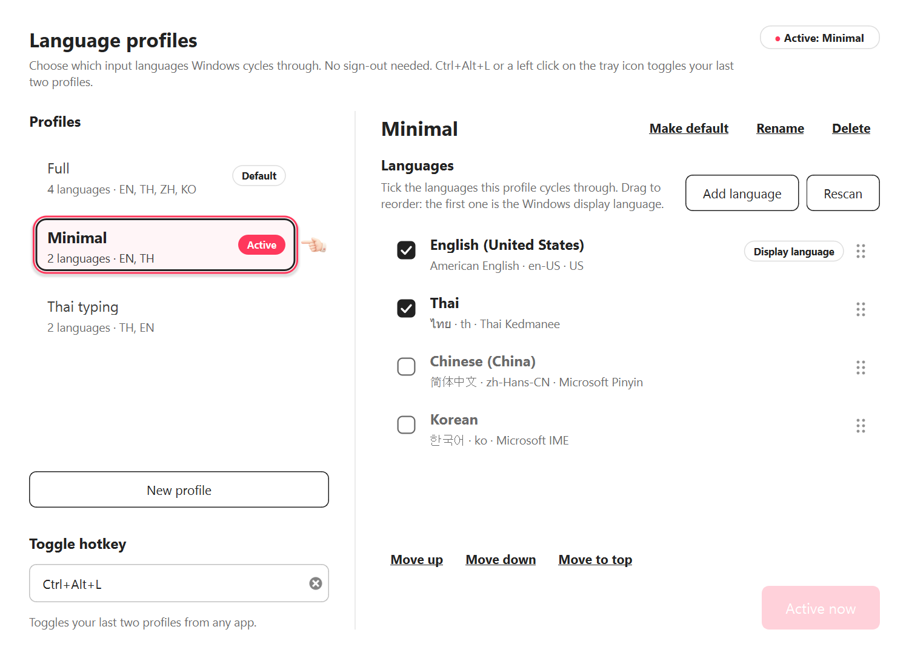
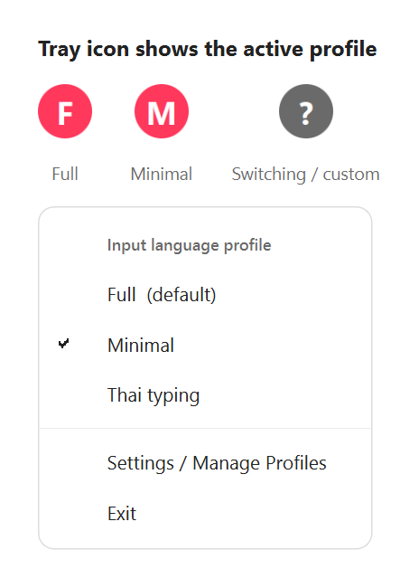
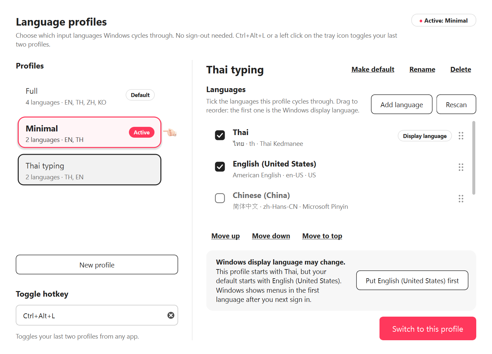
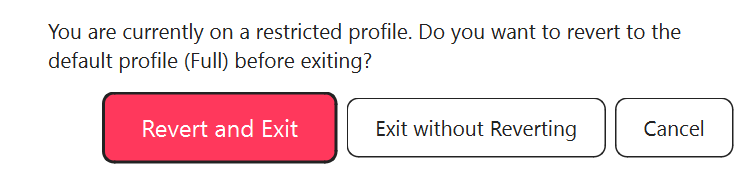
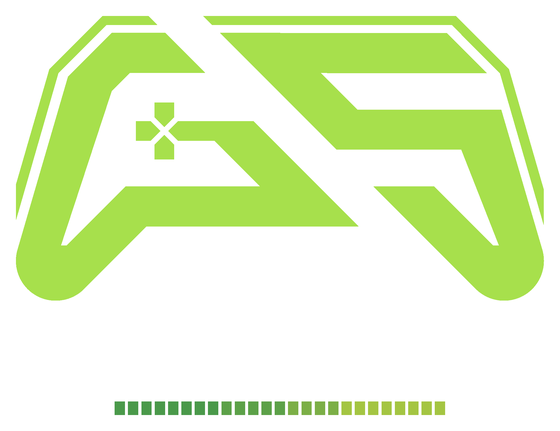

<div align="center">


# Language Profile Switcher

**Switch your Windows keyboard languages between profiles in one click, without a reboot.**

[](https://github.com/Maxkii3/LangProfileSwitcher/releases/latest)
[](LICENSE)
[](#-installation)
[](https://www.python.org/)
[](https://doc.qt.io/qtforpython-6/)

**[Download the installer](https://github.com/Maxkii3/LangProfileSwitcher/releases/latest)** ·
[Install](#-installation) ·
[Usage](#-usage) ·
[Report a bug](https://github.com/Maxkii3/LangProfileSwitcher/issues)

</div>

---

## The problem

Two people share one Windows PC. One of them types in **English, Thai, Chinese and Korean**; the other only
needs **English and Thai**. Windows keeps a single input-language list per account, so `Win+Space` /
`Alt+Shift` cycles through all four languages for both of them, and adding and removing languages in
Settings every time you swap seats takes minutes.

**Language Profile Switcher** keeps named profiles of that list (for example *Full* and *Minimal*) and swaps
between them from the system tray in about a second. No reboot, no sign-out, no admin rights.

## ✨ Features

- **Instant switching:** pick a profile in the tray menu, left-click the tray icon, or press
  **`Ctrl + Alt + L`** to toggle between your last two profiles.
- **Keyboards stay exactly as you set them:** each language keeps its own keyboard layouts and IMEs
  (Microsoft Pinyin, Microsoft IME, Thai Kedmanee and others), so a profile restores them exactly as they were.
- **Display-language protection:** Windows uses the first language in the list as its interface language.
  The app warns you when a profile would change it and fixes the order with one click.
- **Safe exit:** quitting while on a reduced profile asks whether to **revert to your default profile**
  first, so the next person isn't left with missing languages.
- **Active profile at a glance:** in the settings window the active profile is a raised card with a Rausch-red
  border and an *Active* badge, and a pointing hand marks it.
- **System tray app:** the tray icon shows the active profile's initial, it can start with Windows, and
  only one copy runs at a time.
- **Nothing bundled from the author's PC:** on first launch the app reads *your* installed languages
  and builds a **Full** profile (your default) and a **Minimal** profile (your first two languages) from them.
- **Private and offline:** no network access, no telemetry. Settings live in one JSON file on your PC.

## 📸 Screenshots

<table>
  <tr>
    <td width="60%"><br><sub><b>Manage profiles:</b> the hand points at the active profile. Tick the languages a profile cycles through, drag to reorder, and switch with one button.</sub></td>
    <td width="40%"><br><sub><b>Tray:</b> the icon shows the active profile; right-click to switch, open settings, or exit.</sub></td>
  </tr>
  <tr>
    <td width="60%"><br><sub><b>Display-language protection:</b> a one-click fix when a profile would change the Windows UI language.</sub></td>
    <td width="40%"><br><sub><b>Safe exit:</b> offers to restore your default profile before quitting.</sub></td>
  </tr>
</table>

## 📦 Installation

### Option A: installer (recommended)

1. Download **`LangProfileSwitcher-Setup.exe`** from the
   [latest release](https://github.com/Maxkii3/LangProfileSwitcher/releases/latest).
2. Run it. It installs for your Windows user only (no admin prompt) into
   `%LOCALAPPDATA%\Programs\LangProfileSwitcher` and adds a **Start Menu** shortcut, plus optional
   **Desktop** and **Start automatically when I sign in** shortcuts.
3. The settings window opens on the first launch. After that the app lives in the tray.

> **Windows SmartScreen:** the installer is not code-signed yet, so Windows may show *"Windows protected your
> PC"*. Click **More info → Run anyway**. Each release lists the installer's SHA-256 so you can verify the download.

**Uninstall:** *Settings → Apps → Installed apps → Language Profile Switcher*. Your profiles in
`%LOCALAPPDATA%\LangProfileSwitcher` are kept; delete that folder to remove them too. Uninstalling does not
change your language list, so switch to your default profile first if you're on a reduced one.

### Option B: run from source

```powershell
git clone https://github.com/Maxkii3/LangProfileSwitcher.git
cd LangProfileSwitcher
python -m pip install -r requirements.txt     # PySide6
python run.py                                 # --settings opens the window at start
```

Requires Windows 10/11 and Python 3.10+.

## 🧭 Usage

| Action | How |
|---|---|
| Toggle last two profiles | Left-click the tray icon, or press **`Ctrl + Alt + L`** |
| Pick any profile | Right-click the tray icon → click a profile (✔ = active) |
| Create / rename / delete profiles | Right-click → **Settings / Manage Profiles** |
| Choose a profile's languages | Tick or untick them; **drag** (or *Move up / down / to top*) to reorder |
| Add a new Windows language | **Add language** opens *Windows Settings → Language & region*; it appears in the app when you come back |
| Set the fallback profile | **Make default**. Exit offers to revert to it |
| Quit | Right-click → **Exit** (closing the settings window only hides it) |

### Hotkey

The toggle hotkey defaults to **`Ctrl + Alt + L`**. To change it, open **Settings**, click the **Toggle hotkey**
field and press the new combination. Use **Ctrl**, **Alt** or **Win** plus a letter, digit or **F1–F24**
(for example `Ctrl + Alt + K` or `Win + F9`). Clear the field to turn the hotkey off; the tray icon still
toggles. If another app already owns the combination, the field tells you right away.

### Good to know

- **One Windows account:** the language list is per Windows user. The app is for people who share **one**
  account; separate accounts already have separate lists.
- **The first language is the display language.** Keep your Windows UI language at the top of every profile
  (the app warns you when it isn't).
- **Language packs:** Windows can remove language packs that no list uses for a while. Keyboards and IMEs are
  built in and stay, but optional extras (handwriting, speech) may need a re-download. To prevent this, run once
  in an admin PowerShell: `Disable-ScheduledTask -TaskPath '\Microsoft\Windows\MUI\' -TaskName LPRemove`.

## ⚙️ How it works

| Piece | Where |
|---|---|
| Reads the live list from `HKCU\Control Panel\International\User Profile` (instant, no PowerShell) | [`langprofile/winlang.py`](langprofile/winlang.py) |
| Writes it with `Set-WinUserLanguageList` in a hidden PowerShell on a worker thread, then re-reads to verify | [`langprofile/winlang.py`](langprofile/winlang.py) |
| Profiles, toggle rule, atomic JSON save (a corrupt file is moved aside, never overwritten) | [`langprofile/core.py`](langprofile/core.py) |
| Global hotkey via `RegisterHotKey` + a Qt native event filter | [`langprofile/hotkey.py`](langprofile/hotkey.py) |
| Tray, settings window, safe-exit flow | [`langprofile/app.py`](langprofile/app.py), [`langprofile/ui.py`](langprofile/ui.py) |

Config: `%LOCALAPPDATA%\LangProfileSwitcher\config.json` · errors: `error.log` in the same folder.

## 🛠️ Build from source

```powershell
python -m pip install -r requirements-dev.txt       # PySide6 + PyInstaller
winget install JRSoftware.InnoSetup                  # once, for the installer
.\build.ps1                                          # tests -> PyInstaller -> dist\LangProfileSwitcher-Setup.exe
python -m unittest discover -s tests                 # tests only
python tools\screenshots.py                          # re-render docs\images (demo data, touches nothing)
```

## ❤️ Support & Sponsor

Language Profile Switcher is free. If it saves you a few annoying keyboard cycles a day, you can support
its development:

[](https://buymeacoffee.com/maxkii3)
[](https://github.com/sponsors/Maxkii3)

<div align="center">
  <a href="https://www.gsttopup.com/shop" target="_blank">
    
  </a>
  <br/>
  <sub>🎮 <b>Sponsored by / สนับสนุนโดย:</b> <a href="https://www.gsttopup.com/shop">GST Topup</a></sub>
  <br/>
  <sub><b>TH:</b> เติมเกมถูก รวดเร็ว ปลอดภัย แนะนำที่ GST Topup | <b>EN:</b> Affordable, fast, and secure game top-ups at GST Topup</sub>
</div>

Bug reports and ideas are welcome in [Issues](https://github.com/Maxkii3/LangProfileSwitcher/issues). A ⭐ on the
repo helps other people find it too.

## 📄 License

© 2026 [Maxkii3](https://github.com/Maxkii3). **All rights reserved.** You may download the release, or run the
unmodified source, for personal use. Copying, modifying or redistributing the code needs the author's written
permission. See [LICENSE](LICENSE).

Language Profile Switcher is an independent tool, not affiliated with Microsoft. Windows is a trademark of
Microsoft Corporation.
